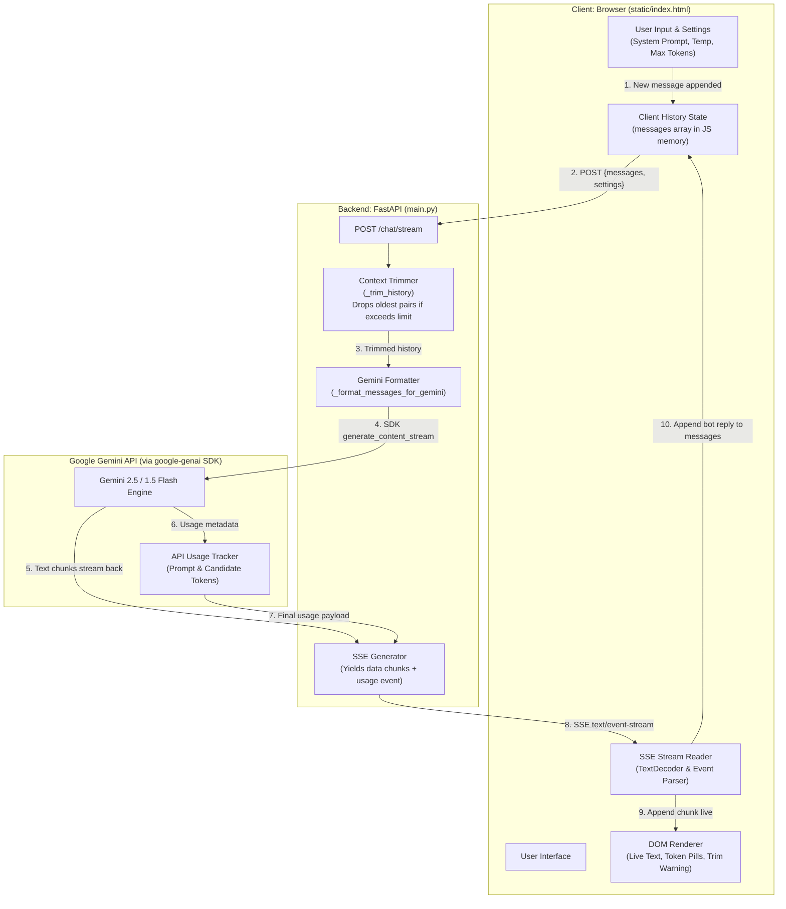

# Gemini LLM Chatbot

A lightweight, full-stack multi-turn AI chatbot application powered by Google Gemini and FastAPI. It delivers real-time conversational AI directly in the browser via Server-Sent Events (SSE) streaming while maintaining client-side conversation history and server-side context window trimming. Built from scratch with vanilla HTML, CSS, and JavaScript, it demonstrates core LLM application patterns without the complexity of heavy frontend frameworks.

---

## Features

- **Real-Time Live Streaming**: Streams Gemini text completions token-by-token directly into the browser using Server-Sent Events (`text/event-stream`).
- **Multi-Turn Conversation Memory**: Tracks conversation history client-side and re-submits context with each request to overcome the stateless nature of LLM APIs.
- **Smart Context Window Trimming**: Automatically prunes the oldest conversation turns in even pairs (user + model) when history exceeds `MAX_HISTORY_MESSAGES` (default: 20), preserving the system prompt and conversation integrity.
- **Live Token Usage Accounting**: Tracks prompt tokens, completion tokens, and total tokens per exchange with a live session-wide accumulator.
- **Interactive Persona & Settings Controls**:
  - Dropdown presets for diverse personas (Helpful Assistant, Coding Tutor, Pirate Captain, Socratic Philosopher) with full custom prompt editing.
  - Temperature slider (0.0 to 2.0) to control response determinism vs. creativity.
  - Configurable max output tokens (1 to 8,192).
- **Proactive Error & Rate-Limit Handling**: Captures and displays user-friendly warnings for Gemini quota/rate limits (HTTP 429), server configuration issues, and network interruptions.
- **Zero-Dependency Frontend**: Clean, responsive, single-file chat UI (`static/index.html`) using pure vanilla HTML5, CSS3, and modern JavaScript—no node_modules or build steps required.
- **Dual Interfaces**: Includes both a web interface (`main.py`) and an interactive terminal CLI loop (`cli_chat.py`).

---

## Architecture Diagram

The diagram below illustrates the end-to-end flow between the browser, FastAPI backend, and Google Gemini API, highlighting where conversation history is stored, where context trimming occurs, and how streaming responses travel.



### Key Architectural Responsibilities

| Component | Responsibility | Location |
|---|---|---|
| **History Storage** | Maintains the full array of conversation turns (`[{role, content}]`). Because LLM APIs are stateless, the client re-transmits history on every turn. | **Browser** (`messages` array in JS) |
| **Context Trimming** | Prevents token exhaustion and runaway latency by pruning older messages when history exceeds `MAX_HISTORY_MESSAGES = 20`. Preserves system prompt. | **FastAPI Server** (`_trim_history()` in `main.py`) |
| **Response Streaming** | Yields partial tokens over HTTP using Server-Sent Events, parsed incrementally via `ReadableStreamDefaultReader`. | **FastAPI Server & Browser** (`/chat/stream` & `readSSEStream()`) |

---

## Setup & Running (Beginner Friendly)

Follow these step-by-step instructions to run the application locally.

### Prerequisites

- **Python 3.10+** installed on your system.
- A **Gemini API Key** from [Google AI Studio](https://aistudio.google.com/).

---

### Step 1: Navigate to the Project Directory

Open your terminal or PowerShell and change into the `llm-chatbot` directory:

```bash
cd "llm-chatbot"
```

---

### Step 2: Create and Activate a Virtual Environment

Isolate the project dependencies by creating a virtual environment:

**On Windows (PowerShell):**
```powershell
python -m venv venv
.\venv\Scripts\Activate.ps1
```
*(If you see an execution policy error on PowerShell, run `Set-ExecutionPolicy -Scope Process -ExecutionPolicy Bypass` first).*

**On macOS / Linux:**
```bash
python3 -m venv venv
source venv/bin/activate
```

---

### Step 3: Install Required Dependencies

Install the necessary libraries (`google-genai`, `fastapi`, `uvicorn`, `python-dotenv`):

```bash
pip install -r requirements.txt
```

---

### Step 4: Configure Your Environment Variables

1. Copy the sample environment file:
   ```bash
   cp .env.example .env
   ```
   *(On Windows Command Prompt / PowerShell, you can use `copy .env.example .env` or `Copy-Item .env.example .env`)*.

2. Open `.env` in any text editor and add your Gemini API key:
   ```env
   GEMINI_API_KEY=AIzaSyYourActualKeyHere
   MODEL_NAME=gemini-2.5-flash-lite
   ```
   > **Tip:** If you encounter strict daily rate limits (20 RPD on free-tier Flash Lite), you can set `MODEL_NAME=gemini-1.5-flash` for higher request limits.

---

### Step 5: Verify the Setup with the Test Script

Run the quick health test to ensure your API key and connection are functioning:

```bash
python test_api.py
```

If configured correctly, you will see a one-sentence reply from Gemini along with token usage statistics.

---

### Step 6: Start the FastAPI Server

Launch the web application with `uvicorn`:

```bash
uvicorn main:app --reload
```

The server will start at `http://127.0.0.1:8000`.

---

### Step 7: Open the Chat Interface

Open your browser and navigate to:

```text
http://127.0.0.1:8000
```

- Type a prompt and hit **Enter** to chat.
- Toggle **Settings (⚙)** to experiment with persona presets, temperature, and max tokens.
- Watch token counts accumulate in real time at the bottom right.

*(Optional)* You can also run the terminal-based conversation loop anytime:
```bash
python cli_chat.py
```

---

## What I Learned

Use the template below to reflect on the core LLM engineering concepts explored in this project:

### 1. Tokens
> *[Explain your understanding here: What is a token? How does tokenization differ from counting words or characters? Why are prompt tokens and completion tokens billed or measured separately?]*

### 2. Context Windows
> *[Explain your understanding here: What is a model's context window? Why is context management essential when LLM APIs are stateless? What happens if you never trim conversation history, and what trade-off occurs when you do trim older messages?]*

### 3. Temperature
> *[Explain your understanding here: How does temperature affect probability distribution over the model's vocabulary? When should you use a low temperature (e.g., 0.0 - 0.3) versus a high temperature (e.g., 0.8 - 1.5)? What happened when you tested different values?]*

### 4. System Prompts
> *[Explain your understanding here: What is the purpose of a system prompt compared to a regular user message? How does framing a persona or constraints in the system instruction steer the model's tone, structure, and behavior throughout the entire chat?]*

---

## Known Limitations

- **Free-Tier Quota & Rate Limits**:
  - The Gemini free tier enforces strict limits on Requests Per Minute (RPM), Tokens Per Minute (TPM), and Requests Per Day (RPD).
  - Models like `gemini-2.5-flash-lite` have a free limit of 20 requests/day, after which the API rejects requests until the quota resets (at midnight Pacific Time).
- **Client-Only In-Memory History**:
  - The conversation array lives exclusively in the browser's JavaScript memory. Refreshing or closing the tab clears the conversation history.
- **No Database Persistence**:
  - There is no persistent database (SQLite, PostgreSQL, etc.) or authentication system; chat sessions cannot be resumed across devices or browser sessions.
- **Linear FIFO Trimming**:
  - Context trimming uses a simple first-in, first-out (FIFO) drop of oldest turns. It does not perform semantic summarization or selective memory retention, meaning early conversation facts are discarded once the threshold is crossed.

---

## Security & Secrets Management

- **Ignored `.env`**: The `.env` file containing sensitive API keys is explicitly excluded in `.gitignore` and is never committed to source control.
- **Clean Repository**: Source code files access credentials strictly via environment variables (`os.getenv("GEMINI_API_KEY")`) loaded through `python-dotenv`.
- **Zero Client Exposure**: The Gemini API key is kept strictly on the FastAPI server and is never exposed to the frontend or sent over the client connection.
