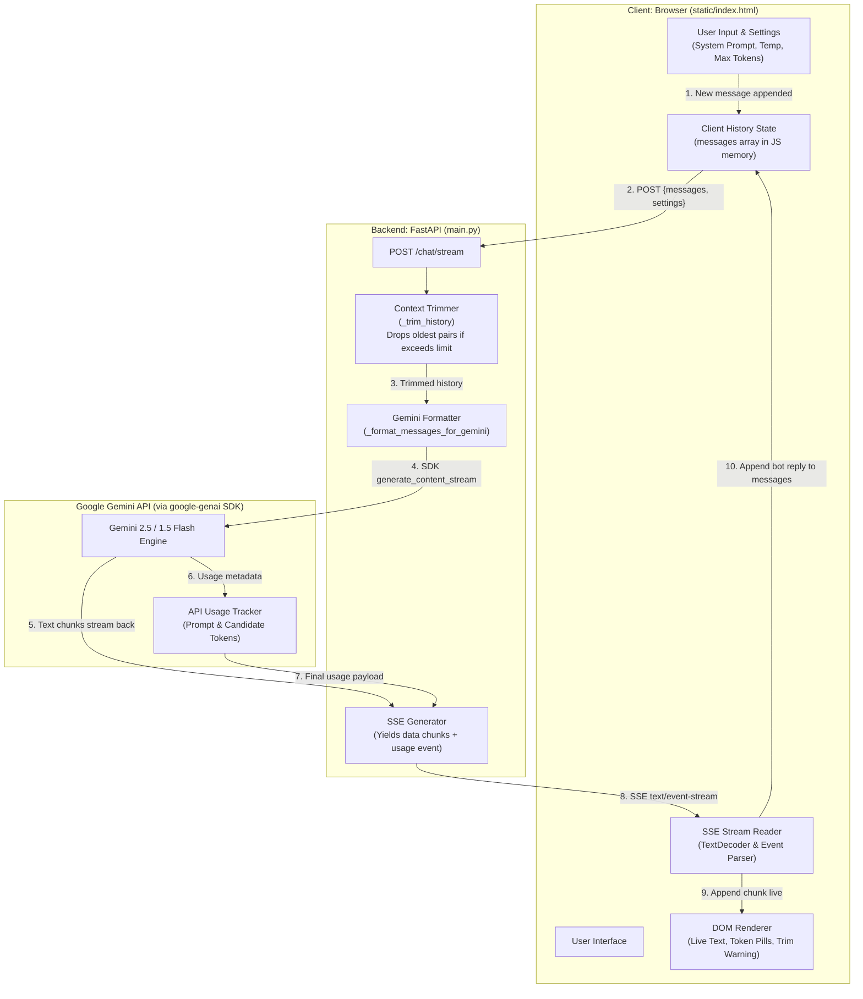
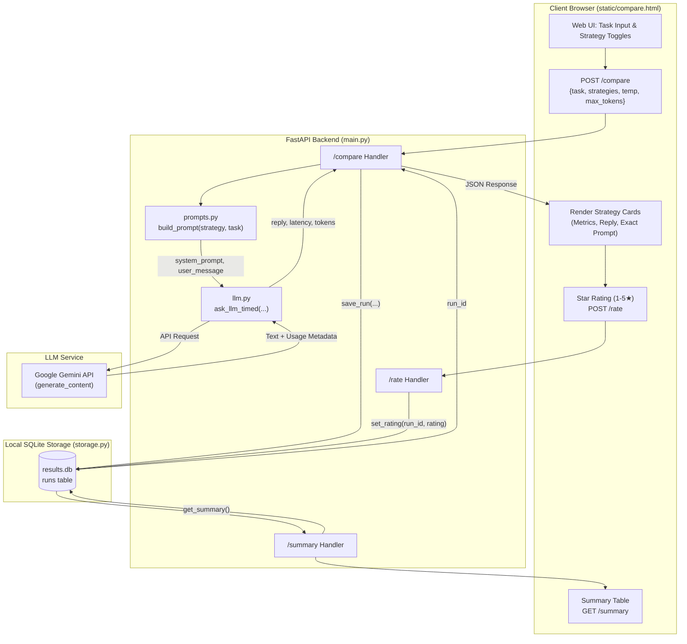

# Gemini LLM Chatbot

A lightweight, full-stack multi-turn AI chatbot application powered by Google Gemini and FastAPI. It delivers real-time conversational AI directly in the browser via Server-Sent Events (SSE) streaming while maintaining client-side conversation history and server-side context window trimming. Built from scratch with vanilla HTML, CSS, and JavaScript, it demonstrates core LLM application patterns without the complexity of heavy frontend frameworks.

---

## Features

- **Real-Time Live Streaming**: Streams Gemini text completions token-by-token directly into the browser using Server-Sent Events (`text/event-stream`).
- **Multi-Turn Conversation Memory**: Tracks conversation history client-side and re-submits context with each request to overcome the stateless nature of LLM APIs.
- **Smart Context Window Trimming**: Automatically prunes the oldest conversation turns in even pairs (user + model) when history exceeds `MAX_HISTORY_MESSAGES` (default: 20), preserving the system prompt and conversation integrity.
- **Live Token Usage Accounting**: Tracks prompt tokens, completion tokens, and total tokens per exchange with a live session-wide accumulator.
- **Interactive Persona & Settings Controls**:
  - Dropdown presets for diverse personas (Helpful Assistant, Coding Tutor, Pirate Captain, Socratic Philosopher) with full custom prompt editing.
  - Temperature slider (0.0 to 2.0) to control response determinism vs. creativity.
  - Configurable max output tokens (1 to 8,192).
- **Proactive Error & Rate-Limit Handling**: Captures and displays user-friendly warnings for Gemini quota/rate limits (HTTP 429), server configuration issues, and network interruptions.
- **Zero-Dependency Frontend**: Clean, responsive, single-file chat UI (`static/index.html`) using pure vanilla HTML5, CSS3, and modern JavaScript—no node_modules or build steps required.
- **Prompt Engineering Comparison Tool**: Side-by-side benchmark studio (`/compare-ui` & `compare_cli.py`) comparing Zero-Shot, Few-Shot, Role-Based, and Chain-of-Thought strategies with latency, token accounting, prompt inspection, 1–5★ human rating, and persistent SQLite storage.
- **Dual Interfaces**: Includes both web interfaces (`/` and `/compare-ui`) and interactive terminal CLI loops (`cli_chat.py` and `compare_cli.py`).

---

## Architecture Diagram

The diagram below illustrates the end-to-end flow between the browser, FastAPI backend, and Google Gemini API, highlighting where conversation history is stored, where context trimming occurs, and how streaming responses travel.



### Key Architectural Responsibilities

| Component | Responsibility | Location |
|---|---|---|
| **History Storage** | Maintains the full array of conversation turns (`[{role, content}]`). Because LLM APIs are stateless, the client re-transmits history on every turn. | **Browser** (`messages` array in JS) |
| **Context Trimming** | Prevents token exhaustion and runaway latency by pruning older messages when history exceeds `MAX_HISTORY_MESSAGES = 20`. Preserves system prompt. | **FastAPI Server** (`_trim_history()` in `main.py`) |
| **Response Streaming** | Yields partial tokens over HTTP using Server-Sent Events, parsed incrementally via `ReadableStreamDefaultReader`. | **FastAPI Server & Browser** (`/chat/stream` & `readSSEStream()`) |

---

## Setup & Running (Beginner Friendly)

Follow these step-by-step instructions to run the application locally.

### Prerequisites

- **Python 3.10+** installed on your system.
- A **Gemini API Key** from [Google AI Studio](https://aistudio.google.com/).

---

### Step 1: Navigate to the Project Directory

Open your terminal or PowerShell and change into the `llm-chatbot` directory:

```bash
cd "llm-chatbot"
```

---

### Step 2: Create and Activate a Virtual Environment

Isolate the project dependencies by creating a virtual environment:

**On Windows (PowerShell):**
```powershell
python -m venv venv
.\venv\Scripts\Activate.ps1
```
*(If you see an execution policy error on PowerShell, run `Set-ExecutionPolicy -Scope Process -ExecutionPolicy Bypass` first).*

**On macOS / Linux:**
```bash
python3 -m venv venv
source venv/bin/activate
```

---

### Step 3: Install Required Dependencies

Install the necessary libraries (`google-genai`, `fastapi`, `uvicorn`, `python-dotenv`):

```bash
pip install -r requirements.txt
```

---

### Step 4: Configure Your Environment Variables

1. Copy the sample environment file:
   ```bash
   cp .env.example .env
   ```
   *(On Windows Command Prompt / PowerShell, you can use `copy .env.example .env` or `Copy-Item .env.example .env`)*.

2. Open `.env` in any text editor and add your Gemini API key:
   ```env
   GEMINI_API_KEY=AIzaSyYourActualKeyHere
   MODEL_NAME=gemini-2.5-flash-lite
   ```
   > **Tip:** If you encounter strict daily rate limits (20 RPD on free-tier Flash Lite), you can set `MODEL_NAME=gemini-1.5-flash` for higher request limits.

---

### Step 5: Verify the Setup with the Test Script

Run the quick health test to ensure your API key and connection are functioning:

```bash
python test_api.py
```

If configured correctly, you will see a one-sentence reply from Gemini along with token usage statistics.

---

### Step 6: Start the FastAPI Server

Launch the web application with `uvicorn`:

```bash
uvicorn main:app --reload
```

The server will start at `http://127.0.0.1:8000`.

---

### Step 7: Open the Web Interfaces

Once the server is running, access either interface in your browser:

- **💬 Gemini Chat Interface**:
  ```text
  http://127.0.0.1:8000
  ```
  - Type a prompt and hit **Enter** to chat with streaming responses.
  - Toggle **Settings (⚙)** to experiment with persona presets, temperature, and max tokens.
  - Watch token counts accumulate in real time at the bottom right.

- **⚖ Prompt Comparison Studio**:
  ```text
  http://127.0.0.1:8000/compare-ui
  ```
  - Benchmark Zero-Shot, Few-Shot, Role-Based, and Chain-of-Thought prompts side-by-side.
  - Expand **"Show exact prompt sent"** on each card to inspect what was delivered to the model.
  - Rate responses 1–5★ and review aggregated rankings in the **"Which strategy works best?"** table.

*(Optional Terminal CLIs)* You can also run the terminal-based tools anytime:
```bash
# Terminal chat conversation loop
python cli_chat.py

# Terminal prompt strategy comparison benchmark
python compare_cli.py
```

---

## Project Structure

```text
llm-chatbot/
├── .env                  # Private Gemini API key and model config (git-ignored)
├── .env.example          # Sample environment configuration template
├── .gitignore            # Git exclusion rules (includes .env and results.db)
├── cli_chat.py           # Terminal multi-turn chat interface
├── compare_cli.py        # Terminal strategy comparison runner
├── llm.py                # Gemini SDK client (generate_content, streaming, ask_llm_timed)
├── main.py               # FastAPI backend: /chat, /compare, /rate, /summary, /history
├── prompts.py            # Prompt engineering strategies (zero-shot, few-shot, role, CoT)
├── README.md             # Project documentation and architecture guide
├── requirements.txt      # Python dependencies
├── results.db            # SQLite database storing benchmark runs and ratings (git-ignored)
├── storage.py            # SQLite persistence layer for benchmark runs, ratings, and summary metrics
├── test_api.py           # API key connection and token sanity test
└── static/
    ├── compare.html      # Prompt strategy comparison web UI with rating & analytics
    └── index.html        # Single-page streaming chat web UI
```

---

## Prompt Comparison Tool

### What It Does
The Prompt Comparison Tool benchmarks different prompt engineering strategies side-by-side against the same task. It evaluates:
- **Zero-Shot**: Raw task with zero scaffolding (the baseline).
- **Few-Shot**: In-context learning using generic worked input-output examples.
- **Role-Based**: Domain-specific persona injected into the system prompt.
- **Step-by-Step (Chain-of-Thought)**: Instructing the model to externalize reasoning steps before stating a final `Answer:`.

For each strategy, the tool measures:
- Output quality & formatting
- Wall-clock API latency (seconds)
- Token counts (prompt, output, total)
- Estimated cost per strategy (configurable pricing constants in `static/compare.html`)
- Exact prompt inspector (reveals system prompt and user message verbatim)
- Human evaluation (1–5 star ratings stored persistently in SQLite)
- Aggregated benchmark table (*"Which strategy works best?"*) ranking strategies by average rating, latency, and tokens.

### How to Open It
1. Start the server (if not already running):
   ```bash
   uvicorn main:app --reload
   ```
2. Open your browser to:
   **[http://127.0.0.1:8000/compare-ui](http://127.0.0.1:8000/compare-ui)**
   *(Or click the **⚖ Strategy Compare** button in the header of the main chat UI)*.
3. You can also run the terminal comparator directly:
   ```bash
   python compare_cli.py
   ```

### Architecture & Execution Flow
The diagram below illustrates how a comparison request flows through prompt generation, model invocation, metrics recording, and database storage:



### Findings

Use this section to record your observations and test results across different tasks:

- **Accuracy & Reasoning Quality**:
  > *[Placeholder: Which strategy gave the most accurate answers for logic, code, or math problems? Did step-by-step reasoning prevent logical leaps?]*

- **Verbosity vs. Conciseness**:
  > *[Placeholder: How did few-shot or role-based prompts affect output length? Did zero-shot remain the most concise?]*

- **Latency & Token Efficiency**:
  > *[Placeholder: How did prompt tokens compare across strategies? Was the increased latency of chain-of-thought justified by higher answer quality?]*

- **Best Overall Strategy**:
  > *[Placeholder: Based on your star ratings in the summary table, which strategy consistently scored highest?]*

---

## What I Learned

Use the template below to reflect on the core LLM engineering concepts explored in this project:

### 1. Tokens
A token is the smallest unit of text that a model processes. It is not exactly a word or a character-it is often a part of a word, a whole word, or punctuation. Tokenization differs from counting characters or words because a single word (like "unbelievable") might be split into multiple tokens (like "un" + "believ" + "able"), depending on the model's vocabulary.

We measure prompt tokens and completion tokens separately because they represent different phases of the request. Prompt tokens are the text we send to the model (instructions, context, history). Completion tokens (also called output tokens) are the text the model generates in response. They are billed and measured separately because generating text (completion) is computationally much heavier and slower for the GPU than just reading the prompt.

### 2. Context Windows
A model's context window is the absolute maximum number of tokens it can "hold in its head" during a single request (this includes both the prompt tokens and the expected completion tokens). Because LLM APIs are stateless (they don't remember your previous requests unless you send the whole history back every time), context management is essential. If you never trim the conversation history, the API will eventually reject the request because it exceeds the context window limit. However, if you do trim older messages to save space, there is a trade-off: the model loses access to that older information, meaning its "memory" of the conversation is reduced and it might forget important early instructions.

### 3. Temperature
Temperature controls the randomness of the model's output. It scales the probability distribution over the model's vocabulary: a low temperature (0.0 - 0.3) makes the model highly deterministic and likely to pick the most probable next word (great for coding, math, and factual answers). A high temperature (0.8 - 1.5) flattens the distribution, giving less likely words a chance to be chosen, which increases creativity but also increases the risk of hallucinations (great for brainstorming or storytelling). During testing, I noticed that setting the temperature to 0 gave nearly identical responses for zero-shot and step-by-step, whereas higher temperatures showed much more variety in wording.

### 4. System Prompts
While a user message is the specific task or question, the system prompt acts as the "constitution" for the AI. It sets the overarching rules, persona, and constraints for the entire chat session. By framing a persona in the system prompt (e.g., "You are an expert Python developer"), the model's attention shifts toward specific vocabulary, tone, and formatting standards. It steers the model to behave consistently throughout the chat, which is much more reliable than trying to cram those constraints into every single user message.

---

## Known Limitations

- **Free-Tier Quota & Rate Limits**:
  - The Gemini free tier enforces strict limits on Requests Per Minute (RPM), Tokens Per Minute (TPM), and Requests Per Day (RPD).
  - Models like `gemini-2.5-flash-lite` have a free limit of 20 requests/day, after which the API rejects requests until the quota resets (at midnight Pacific Time).
- **Client-Only In-Memory History**:
  - The conversation array lives exclusively in the browser's JavaScript memory. Refreshing or closing the tab clears the conversation history.
- **No Database Persistence for Chat**:
  - The chat conversation array lives exclusively in the browser's JavaScript memory. Refreshing or closing the tab clears chat history (note: Prompt Comparison runs are stored persistently in SQLite `results.db`).
- **Linear FIFO Trimming**:
  - Context trimming uses a simple first-in, first-out (FIFO) drop of oldest turns. It does not perform semantic summarization or selective memory retention, meaning early conversation facts are discarded once the threshold is crossed.

---

## Security & Secrets Management

- **Ignored `.env`**: The `.env` file containing sensitive API keys is explicitly excluded in `.gitignore` and is never committed to source control.
- **Clean Repository**: Source code files access credentials strictly via environment variables (`os.getenv("GEMINI_API_KEY")`) loaded through `python-dotenv`.
- **Zero Client Exposure**: The Gemini API key is kept strictly on the FastAPI server and is never exposed to the frontend or sent over the client connection.
